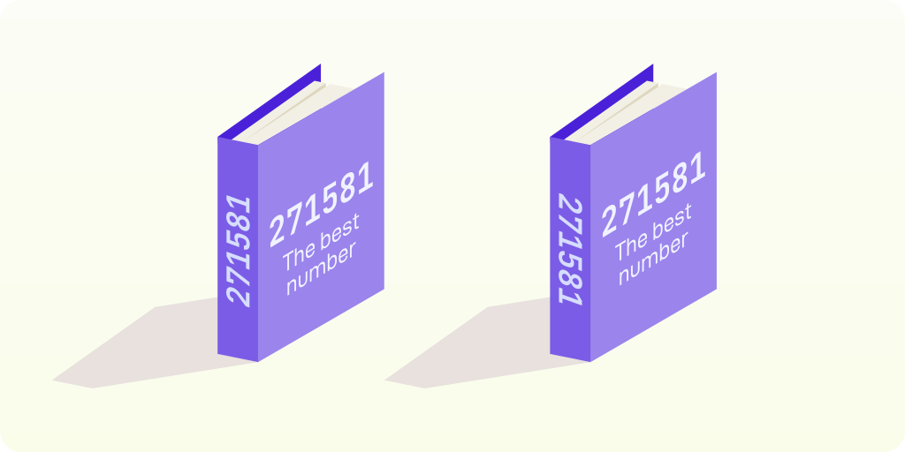
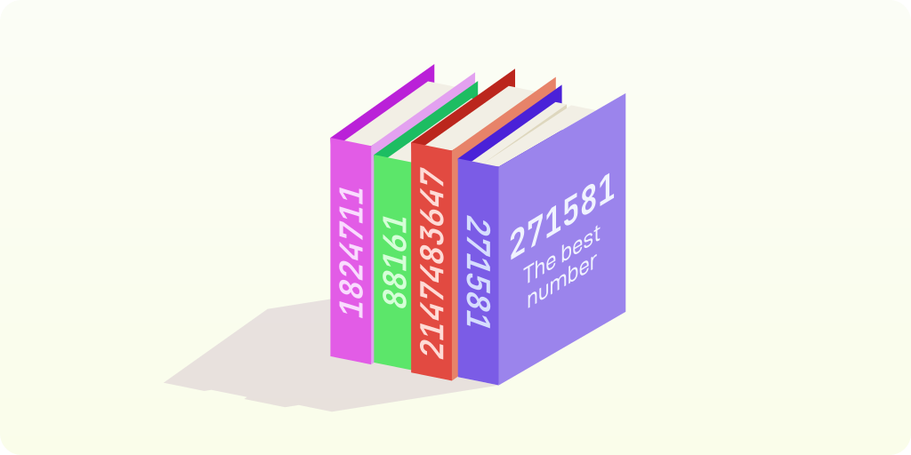
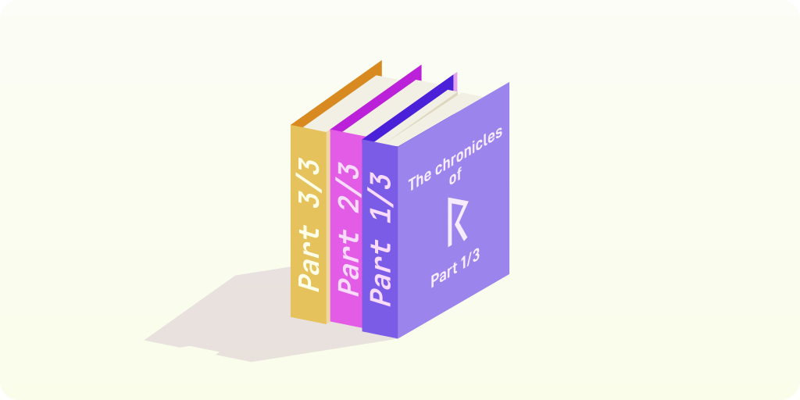

# What is NBT
**Named Binary Tag**, **NBT** for short, is a binary data format used by Minecraft to store and exchange information. NBT can be more or less seen as a binary alternative to JSON. It easily encodes and decodes, reducing any formatting and parsing overhead that JSON would introduce. It is thus a very effective format for data exchange and storage, though it comes at the disadvantage that it is not human-readable (in the sense that you cannot just open an NBT file in a text editor and see immediately what is going on, though you can often inspect them using special tools).

In this chapter we will extensively explain the NBT format, how it's structured, and how you could read and write NBT yourself. Understanding NBT is useful for many reasons if you like to play Minecraft, especially if you want to do more technical stuff like writing datapacks or mods, or editing maps. Maybe you are an excited new programmer with ambitions and want to build your own NBT editor. I've got you covered, we'll cover all the details here!

NBT is used extensively by _Minecraft: Java Edition_, and in lesser amounts also by _Minecraft: Bedrock Edition_. The formats are slightly different across both editions of Minecraft, as we'll see throughout this chapter.

## Tags
At the very fundamental level, every data object packaged in NBT format is packaged as a **tag**. Every tag has a _tag ID_, a _name_ and a _payload_. One NBT file or message typically encodes one single tag, though there are possibilities to encode tags inside other tags, that we'll see in a bit.

Tag
: The fundamental shape of data in NBT.

The **tag ID** identifies the type of tag using a small identifier. This hints at a very important detail about NBT tags: there are different types of tags. The tag ID marks exactly what type a tag is, so that anyone or anything that wants to decode the NBT knows exactly what the data is going to be structured like and what they can expect.

The **name** is the second part of a tag, and it makes the tag identifiable when grouped with other tags. In NBT, every tag has a name. Even when you don't group a tag with any others, the tag must have a name, despite it not being any relevant in most cases. Minecraft often sets irrelevant names to be empty (a name of zero characters long).

The **payload** is the final part of a tag, and this is where the actual data of the tag is structured. You can see the tag ID and the name as a sort of _header_ for a tag, and the payload as its _content_. The way the payload is structured is determined by the tag ID.

Tag ID
: A small number that identifies the format of a tag.

Name
: A human-readable name that identifies a tag from others in a collection.

Payload
: The data stored in a tag, formatted in accordance to the _tag ID_.

### Types
As we just discussed, the tag ID tells us exactly how a tag's payload is structured. This tag ID is a number (more specifically, it's a single byte), and a different number means a different format. We'll see each tag in more detail soon, but here's an overview.

| ID     | Tag Type   | Description                                                                                 |
|:------:|------------|---------------------------------------------------------------------------------------------|
|    0   | End        | A special end marker, we'll see the meaning of this in a bit.                               |
|    1   | Byte       | One byte of data, often a small number or a boolean value.                                  |
|    2   | Short      | Two bytes of data, usually a small-ish number.                                              |
|    3   | Int        | Four bytes of data, usually a number.                                                       |
|    4   | Long       | Eight bytes of data, usually a very large number.                                           |
|    5   | Float      | An IEEE 754 floating point value, of 32 bits (4 bytes).                                     |
|    6   | Double     | A double precision IEEE 754 floating point value, of 64 bits (8 bytes).                     |
|    7   | Byte Array | An array of bytes, of arbitrary length. The payload includes length information.            |
|    8   | String     | An UTF-8 encoded string. Again, length is included in the payload.                          |
|    9   | List       | A list of payloads. Each payload is the same type, which the first payload byte determines. |
|   10   | Compound   | A collection of full tags, each with an ID, name and their own payloads.                    |
|   11   | Int Array  | An array of Int values (each 4 bytes).                                                      |
|   12   | Long Array | An array of Long values (each 8 bytes). Not supported by old versions of Minecraft (<1.13). |
|   13+  | Reserved   | These IDs are unused.                                                                       |

### Primitives
When we mention **primitive tags** or **primitives**, what we mean is any tag with a type ID from 1 to 6 (inclusive). Those are: _Byte_, _Short_, _Int_, _Long_, _Float_ and _Double_. All of these are numeric values, and typically represent numbers, though other than Float and Double, they are also often used to store more compressed data. The primitives are named after their equivalent types types in Java: `byte`, `short`, `int`, `long`, `float` and `double`. If you know what each of these types is in Java, then you know exactly what the payloads of these tags look like.

Primitive Tag
: A tag that stores a single number of any kind.

The payload layouts of primitives are all a fixed width: no matter what the data they store looks like, it will be a predefined amount of bytes long. The exact size of the payload is dependent on the specific type of tag, the specific size of each primitive is mentioned in the tables below. The overall tag layouts of these primitives thus are pretty straightforward:

| Byte    | Length (in bytes)              | Data             |
|:-------:|:------------------------------:|------------------|
| 0       | 1                              | Tag ID           |
| 2       | 2                              | Name length: _N_ |
| 3       | _N_                            | Name bytes       |
| _N_ + 3 | 1 to 8 (depending on type) | Payload          |

We will see in a bit how names of tags work.

### Integers
The **Byte**, **Short**, **Int** and **Long** tags store integers. More specifically, they store _signed_ integers. To put it simply, it means you can slap a `-` in front of them and that would also be a valid value. Integers have the limitation that they are all restricted to a range. After all, you can only store so much different numbers in a fixed amount of bits.

| Type  | Payload Size | Minimum (inclusive)               | Maximum (inclusive)               |
|-------|--------------|-----------------------------------|-----------------------------------|
| Byte  | 1 byte (duh) | -128                              | 127                               |
| Short | 2 bytes      | -32,768                           | 32,767                            |
| Int   | 4 bytes      | -2,147,483,648                    | 2,147,483,647                     |
| Long  | 8 bytes      | -9,223,372,036,854,775,808        | 9,223,372,036,854,775,807         |

> [!NOTE]
> NBT does not have a dedicated tag type for boolean values, i.e. "true" and "false". Instead, Minecraft uses Byte tags, where any non-zero value is treated as "true", and zero is treated as "false". Minecraft _usually_ accepts any primitive tag when it is looking for a boolean, though it always exports booleans as Byte tags.

### Floats
The **Float** and **Double** tags also store numbers, but they work a little differently. Most importantly, they can store fractional numbers, e.g. 0.5 or 3.1415. We call these numbers _floating point numbers_, _floats_ for short. Again, there are limitations, but they are different from integers. We'll not cover floating point numbers in excruciating detail here, but here's a short crash course:

- floats consist of a signed, fixed-precision _mantissa_, paired with a _magnitude_ or _exponent_, much like scientific notation;
    - e.g. 11400 can also be written as 1.14 &times; 104, where 1.14 is the mantissa and 4 is the magnitude;
    - similarly, in binary, 10010112 can be written as 1.0010112 &times; 26;
- floats have no direct numeric limit, they go from negative infinity to positive infinity;
- the magnitude has a lower and upper bound: below the lower bound the value is considered 0, and above the upper bound the value is considered _infinity_;
- more bits means more precise floating point numbers and larger magnitude range;
- large float values are less accurate than small float values;
- some float values are invalid and are called _not a number_: _NaN_;
- negative zero and positive zero are logically equivalent but are different values;
- pretty much all uses of floats nowadays follow the [IEEE 754 standard](https://en.wikipedia.org/wiki/IEEE_754).

> [!NOTE]
> Throughout the book I'm using subscripts to indicate the base of each number: 111012 is a binary numeral, 29 or 2910 is a decimal numeral (the ones we know and love), and later in the chapter we'll also see hexadecimal numerals: 1C16.

Good, now you're up to date on what floats are. NBT allows storing _single-precision_ (32-bits) floats and _double precision_ (64-bits) floats, using respectively the _Float_ tag type and _Double_ tag type. Like any other proper supporter of floats, NBT stores them according to the [IEEE 754 standard](https://en.wikipedia.org/wiki/IEEE_754). This means that we can have values like Infinity, -0 and NaN in NBT.

| Type   | Payload Size | Smallest Non-Zero Value       | Largest Finite Value                        |
|--------|--------------|-------------------------------|---------------------------------------------|
| Float  | 4 bytes      | 1.4 &times; 10-45  | 3.4028235 &times; 1038           |
| Double | 8 bytes      | 4.9 &times; 10-324 | 1.7976931348623157 &times; 10308 |

The limits in the above table only detail the range of finite, positive values that can be represented using each float type. They do not include zero, negative zero, infinity, negative infinity and NaN, which can all also be represented using either float type.

### Side quest 1: Endianness
Ah yes, endianness, one of the many ways in which computer systems have never come to an agreement. **Endianness**, sometimes called **byte order**, defines in which order numeric values are split into bytes. We have two types of endianness, _big-endian_ and _little-endian_.

Endianness
: The order in which bigger numbers are stored as bytes.

To see what endianness is about, let's suppose you were designing a book cover about the beautiful number you want to write to your disk: 271581. On the spine of the book, you want to write the number, but the spine is too thin to write the number horizontally. The solution: you write it vertically. However, do you write it upwards or downwards?

<figure>

<figcaption>Figure 1: Two ways in which a book cover can be designed.</figcaption>
</figure>

You may prefer one over the other, but someone else might have a different opinion here. Either way, you'll need to tilt your head or the book to be able to read it properly (assuming you lack the cognitive skill to rotate the text in your mind). You can imagine binary data to be a row of books where each number is assigned its own book. Now, someone trying to read this data has to know whether they would need to tilt their head left or right to be able to read the number on the book. If they get it wrong, they will see all the numbers upside down, and most likely will read garbage.

<figure>

<figcaption>Figure 2: A row of number books to represent binary data. The last book uses a different endianness, which will cause issues when someone tries to read these numbers and expect all of them to read upwards. Nevertheless, neither upwards or downwards numbers are more ideal than the other.</figcaption>
</figure>

In reality, we do not write digits on the spines of books. Instead, we write bytes, smaller numbers with 8 bits of information. When reading and writing NBT data, we will always read or write bytes. Now it is true that one byte is just 8 bits, or 8 "ones and zeroes", but it really just behaves like one unitary symbol of information. There are 256 different symbols and when reading or writing files or sending or receiving binary data, it will always be one byte at a time and never individual bits. This means that the endianness of one byte is completely irrelevant to us. However, the endianness of numbers bigger than bytes does matter.

- **Big-endian** means that the first byte we read when reading a number is the _most significant byte_. In big-endian base-10, we would read 271581 as "2-hundred 7-ty 1 thousand, 5-hundred 8-ty 1".numbers.

- **Little-endian** means that the first byte we read when reading a number is the _least significant byte_. In little-endian base-10, we would read 271581 as "1 8-ty 5-hundred, thousand 1 7-ty 2-hundred".

The latter sounds weird, and it is weird because this is not how English works. But consider Dutch, they would read 271581 as "2-honderd 1 en 7-tig duizend, 5-honderd 1 en 8-tig". German works similarly. This is neither really big or little-endian, but it demonstrates clearly that different languages can read numbers in different orders. Binary formats are much like languages, where some speak in big-endian order and some speak in little-endian order.

Now here is the conclusion that you have been waiting for. **NBT uses big-endian numbers** ...except if you are on _Minecraft: Bedrock Edition_. **_Minecraft: Bedrock Edition_ NBT uses little-endian numbers.** Yes, Minecraft is unfortunately not very consistent in its NBT usage. The truth is though, NBT is most commonly used by the Java Edition of the game, and Java Edition is also the original version of Minecraft, so most NBT is big-endian anyway.

The endianness of NBT applies to all numeric values used throughout the format. This includes all primitives, but it's not limited to it. For example, as we'll see in a bit, arrays, lists and strings all carry a length as part of their payload, which is a number that is subject to endianness.

### Strings
Alright, enough about numbers, how do we store text? Well, we've already briefly mentioned tag names: these are strings, but the name of a tag is supposed to be unique among a collection of tags, so this is not ideal when you are storing for example the different lines of text on a sign. When reading collections of tags, NBT readers most often discard any duplicate names and only keep the name they read last. This means that if we have a sign with four lines just saying "AAA", then we would only ever see the last line of text if we stored this text in the name of a tag. Not ideal.

The **String** tag prevents this, by allowing us to store text not as a name but as a payload. The name of a tag actually follows the exact same format as a String payload, namely a 2-byte length followed by that amount of UTF-8 bytes.

| Byte    | Length (in bytes)              | Data                |
|:-------:|:------------------------------:|---------------------|
| 0       | 1                              | Tag ID              |
| 2       | 2                              | Name length: _N_    |
| 3       | _N_                            | Name bytes          |
| _N_ + 3 | 2                              | Payload length: _M_ |
| _N_ + 5 | _M_                            | Payload bytes       |

The length that precedes a name or string payload is an **unsigned** number, meaning that it ranges from 0 to a maximum of 65535. That is twice as high as the 2-byte Short payload can reach, but at the cost of having no possibility for negative values. Luckily this doesn't matter, because writing down a sentence of -42 letters isn't really possible. The use of two bytes means that names and strings are inherently limited to 65535 bytes.

> [!IMPORTANT]
> The length of a string is stored in _bytes_, not in _characters_. This is an important distinction because in UTF-8, one character can take up to 4 bytes. We'll discuss UTF-8 in a bit.

Name and string lengths are the only occurrence of _unsigned_ numbers across NBT. Lengths of arrays and lists are, for some reason, _signed_.

Unsigned Number
: A number without a sign, i.e. a number that cannot be negative.

Signed Number
: As opposed to an unsigned number, a number that can be negative. The maximum is only half that of an unsigned number.

### Side quest 2: UTF-8
Tag names and strings follow the **UTF-8** standard for encoding text. This means that the character scheme is inherently the Unicode character table. UTF-8 is the de-facto standard for text encoding nowadays, as it is compact, efficient to encode and decode, and it covers the entire **Unicode** table and therefore every possible character you ever wish to store in your string.

UTF-8 is usually naturally supported by the language you are working in. For example, the Rust standard library expects that strings are UTF-8 and may behave in undefined ways if strings are not UTF-8. However, many languages also use UTF-16 (Java does this), which is a bit easier to deal with when manipulating strings, but it is less common and works a bit strangely (plus it is subject to endianness, while UTF-8 is not). There are many resources describing UTF-8 in more detail, but fear not because UTF-8 is actually pretty simple.

The **Unicode Table** has space for 1114112 symbols, plenty of space to cover any writing system ever used on Earth, including old-Germanic Runes and even Egyptian hieroglyphs. It also covers emoji and many miscellaneous symbols such as arrows, dingbats, a lot of mathematical symbols and even has entire sections for private use (icon fonts use this for example). Each character is assigned a unique number, called a **codepoint**. For example, the letter A maps to the codepoint 65. At the very core, computers only understand numbers, so this is a great way to map computer-readable numbers and human-readable symbols.

Unicode Table
: A universal table that assigns every possible character a unique number.

Codepoint
: The unique number that identifies a symbol in the Unicode table.

Even though there are many many symbols in the Unicode table, the most commonly used symbols are Latin letters: the letters you are looking at right now! Unicode is arranged in such a way that the most common characters have lower numbers. UTF-8 encodes lower numbers with less bytes, meaning that more common characters are encoded with less bytes. In fact, the first 128 characters only take up one byte, yet they cover more than 95% of what you need for the English language. Many other languages use the same script as English, so using just one-byte strings of characters you already have enough for most Latin-scripted languages! These 128 characters were originally a separate encoding, **ASCII**, the most common character encoding before UTF-8 came around. In fact, UTF-8 is designed in such a way that any ASCII-encoded text can be directly read as UTF-8!

ASCII
: A character encoding specifying only 128 characters.

UTF-8
: An extension of ASCII that covers all 1114112 characters of the Unicode table.

Decoding a codepoint encoded in UTF-8, imagine that row of books again. Each book tells a story about a character, but some stories are written as a series of multiple books. For example, the elder rune for R, named Raid&omacr;, is encoded as a trilogy of books. These books are then neatly labeled "Part 1 of N", "Part 2 of N", et cetera (N is the amount of books in the series here). You, the decoder, want to read each story in the correct order, because without a coherent story it's going to be hard to know what character you are reading about.

<figure>

<figcaption>Figure 3: A trilogy about Raid&omacr;, the elder rune for R, which has the codepoint 5809.</figcaption>
</figure>

Labelling in UTF-8 is much like the part numbers of a book series, except that only the first book indicates how much parts there are, and the follow-ups don't have a number at all, only a label saying "follow-up". So the above trilogy would be labeled like "The chronicles of Raid&omacr;, the trilogy", followed two books just named "Follow up". Without the first part of the story, those follow-ups are completely meaningless.

1. a single byte of the form `0aaabbbb`2 encodes the binary value `aaabbbb`2, encoding a codepoint up to 127;
2. a "dology" of bytes of the form `110aaabb 10bbcccc`2 encodes the binary value `aaabbbbcccc`2;
3. a "trilogy" of bytes of the form `1110aaaa 10bbbbcc 10ccdddd`2 encodes the binary value `aaaabbbbccccdddd`2;
4. a "quadrilogy" of bytes of the form `11110abb 10bbcccc 10ddddee 10eeffff` encodes the binary value `abbbbccccddddeeeeffff`2.

Each of the letters here represents an arbitrary bit, 0 or 1. For example, the letter A, codepoint 65, has a binary value of 10000012, and we encode this as `01000001`2. The Raid&omacr; rune, of which we just depicted the trilogy, has binary code 10110101100012 and is encoded `11100001 10011010 10110001`2.

With great power comes great responsibility. That's why not every sequence of bytes is valid UTF-8. For example, the singleton byte sequence `10100101`2 is not valid UTF-8. It's like reading a follow-up book without having read the first part, you're jumping into the middle of a story with zero context. What is a bit weirder is that there is a whole range of codepoints that look like valid UTF-8 and do encode to valid numeric values, but they simply are not valid. These are the **surrogates**.

Surrogates are codepoints that are specifically reserved in the Unicode table, and they are specifically for UTF-16 encodings. Why? Well, **UTF-16** encodes symbols using 16-bit long words (as opposed to UTF-8, which uses 8-bit words). However, 16-bit words only go up to codepoint 65535, while there are 1114112 symbols in the Unicode table. This is why the unicode table devises a whole section dedicated specifically to _low surrogates_ and _high surrogates_. These characters must always come in pairs, first a high surrogate and then a low surrogate, and together they are able to cover all remaining 1048576 symbols that UTF-16 otherwise cannot cover. Surrogates cover the codepoint range 55296 to 57343 (inclusive).

UTF-16
: A character encoding consisting of 16-bit units, as opposed to UTF-8, which consists of 8-bit units. UTF-16 is subject to endianness.

Surrogates
: Reserved codepoints used by UTF-16 encoding to represent codepoints greater than 65535. These constitute the codepoint range 55296 to 57343 (inclusive).

The Unicode specification states that no character encoding should directly encode surrogates. This means that encoding a surrogate codepoint (say 56812) is not valid in UTF-8. UTF-16 must also never encode a "dangling" surrogate, as surrogates must always come in pairs. This is again similar to reading only one half of a duology.

As a cherry on top of illegal UTF-8 sequences, we have any byte of the form `11111xxx`2. The last three `x`es represent any arbitrary bit here. These are invalid since UTF-8 expects a zero bit in any of the five most significant bits of a byte. The position of this zero tells the UTF-8 decoder what kind of byte this is. Just scroll back a bit, to the four ways UTF-8 encodes a codepoint: you'll notice that every byte must have a 0 somewhere in its first five bits. An especially notable invalid value is `11111111`2. This byte is not valid UTF-8, making it an ideal end marker when encoding UTF-8 data, although traditionally this is done using a NULL character (the character with codepoint 0). NBT stuck with a length-payload encoding, which is more beneficial in the end as it tells you the length in advance, allowing you to allocate enough memory to store the entire string.

Now usually you do not need to perform the UTF-8 conversion yourself. Programming languages often handle UTF-8 directly, or have the tools to convert from UTF-8 to the format used by the programming language. Nevertheless, it is relevant for NBT as that specifically uses UTF-8 encoding for tag names and String payloads. 

### Arrays
NBT has three dedicated array tags: **Byte Arrays**, **Int Arrays** and **Long Arrays**. Each of these stores amount of integers. These integers follow the same payload semantics as their respective primitive payloads.

In the very beginning, NBT only had Byte Array tags. Not much later, Int Array tags were added. These two used to be the only kinds of array tags in NBT for a long while, until Minecraft 1.12 came around and introduced Long Array tags. For backwards compatibility, the tag IDs of Int Array tags (11) and Long Array tags (12) are not coherent with the tag ID of Byte Array tags (7).

Each of the three array tags begins with a **signed** 32-bit integer (4 bytes), which indicates the length of the array. Making the array length signed is a bit of a weird decision, but Java does not have unsigned numbers, and arrays in Java cannot have more than 2147483647 elements (the limit of a signed 32-bit integer). The exact limit depends on the JVM used, it's usually slightly less than the mentioned value, but never more.

Following the length is that length amount of integers, packed tightly together. For Byte Arrays, each element is one byte long, for Int Arrays, each element is four bytes long, and for Long Arrays, each element is eight bytes long. Like primitives, these integers are all signed and follow the endianness of all other numbers.

| Byte    | Length (in bytes)                                             | Data                |
|:-------:|:-------------------------------------------------------------:|---------------------|
| 0       | 1                                                             | Tag ID              |
| 2       | 2                                                             | Name length: _N_    |
| 3       | _N_                                                           | Name bytes          |
| _N_ + 3 | 4                                                             | Payload length: _M_ |
| _N_ + 7 | _M_, _M_ &times; 4 or _M_ &times; 8   (depending on type) | Payload elements    |

> [!IMPORTANT]
> Unlike in names and String tags, the length indicates the number of _elements_, not the number of _bytes_. This means that an Int Array tag can take up more bytes than a Byte Array tag can.

### Lists
A **List** tag is a tag that stores an arbitrary amount of tag _payloads_ of some type. Every payload in a List tag is of the same type, but the type can be different per List tag. This is enabled by the first byte of a List tag's payload, which indicates the tag ID of the payloads.

What follows the initial element tag ID of the List is mostly the same as the Array tags.

### Side quest 3: Lists vs Arrays
Now you might wonder: why do there exist specific Byte Array, Int Array and Long Array tags? This has to do with a small optimization used by _Minecraft: Java Edition_. You see, Java is a language that uses **garbage collection**, a technique where unused memory is automatically cleaned up. Let's have a little look into how this impacts the design of NBT.

A **garbage collector**, or **GC** for short, is a task that automatically runs in the background of any Java program, and it constantly tracks any memory you allocate. Once you stop using some memory, it will notice this, and eventually clean up the memory. This is opposed to a language like C or C++, where you manually request memory from the operating system, and have to manually return it. The operating system will never know whether you are done with some memory or not, so if you forget to return your memory, it will linger unused, just uselessly taking up space in your RAM until the program exits. This is called a **memory leak**.

Garbage Collector
: A background task of some program that keeps track of memory usage and cleans up unused memory.

Memory Leak
: A phenomenon where unused memory is never returned to the operating system.

Memory leaks are a very notorious problem in software development, and garbage collection is the solution. However, garbage collection isn't easy. Garbage collectors are under a lot of pressure, having to manage every bit of memory that you allocate, use for 2 microseconds and then discard again. This brings overhead into your programs, and if you are not careful, this overhead can become very noticeable. In Minecraft, this overhead is often experienced as lag spikes: repetitive moments in which the game just briefly freezes.

A key optimisation technique in Java is to reduce the number of **object allocations**. Whenever you store some object in a variable or a field in Java, you are really just storing a reference to some memory. Every time you instantiate an object in Java, some memory is requested from the operating system and as long as a reference is kept to it, the garbage collector will not clean it up. This happens even for very tiny objects, like some tuple of coordinates. This means that every object is tracked by the garbage collector, and the more objects you create, the more work the garbage collector has to do to keep track of everything and the slower your program becomes. This is why objects are often reused in Java.

Object Allocation
: Requesting memory to store an instance of an object.

On the flipside, Java has a bunch of primitive types, which are not treated as objects. These primitive types are numbers and booleans, and whenever you store them in a variable or a field, their value is actually literally in that variable or a field. This is contrary to objects, whose value is stored in allocated memory, while the variable or field only stores a reference to that memory.

> [!NOTE]
> Rust is well-known for a whole different approach to avoiding memory leaks. Instead of using a garbage collector, Rust has specific rules for where memory goes and who references it. This allows the compiler to know exactly when memory is no longer used, and makes it possible for the compiler to automatically insert code that cleans up unused memory. This prevents memory leaks without the overhead of garbage collection, making Rust a very powerful language.

Now why is this relevant for NBT? Well, consider that List tags can contain different types of payloads. This would mean that to represent NBT lists in Java, you need some sort of **polymorphism**. Polymorphism is basically the notion of saying "every integer is a number, but not every number is an integer". The NBT equivalent of this is "every integer is a payload, but not every payload is an integer". Java has natural polymorphism, but only on objects. This means that you must necessarily instantiate every element of a List tag as an object. This is far from ideal, as this would introduce lots of object allocations. Especially for simple arrays of primitives, you could just be storing all those numbers directly instead of storing references to tiny objects that each store a number.

Polymorphism
: A notion where a value is allowed to be of a variety of types. NBT is polymorphic as it has different types of tags.

This, and exactly this, is why NBT has separate Array tags. Numeric values are not objects in Java, they do not need allocations. Thus, Array tags have a slight performance advantage.